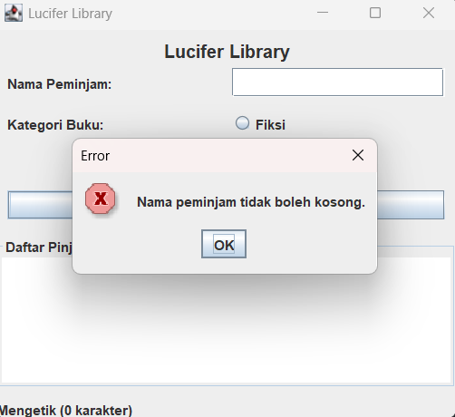
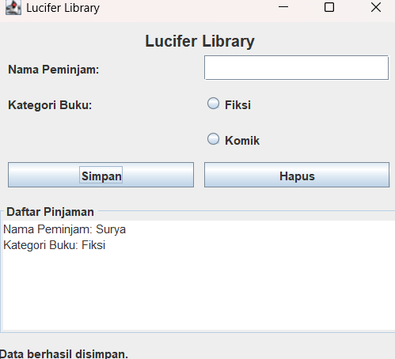
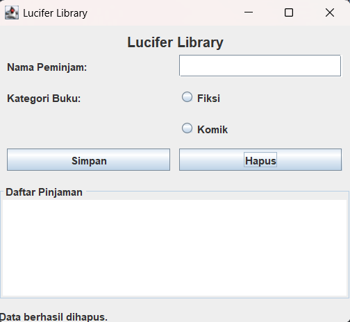

# Latihan GUI Java - Peminjaman Buku

## Nama: I Gde Surya Laksana Diputra
## NIM : F1D02410051

## Deskripsi

Latihan eksplorasi GUI dengan Java Swing untuk mencatat peminjaman buku. Pengguna mengisi nama peminjam, memilih kategori buku (Fiksi atau Komik), lalu menekan tombol Simpan untuk menambahkan data ke daftar pinjaman. Jika nama kosong atau kategori belum dipilih, aplikasi menampilkan dialog error. Tombol Hapus mengosongkan kolom nama, pilihan kategori, dan seluruh daftar pinjaman, sedangkan label status di bagian bawah menampilkan hasil aksi terakhir.

## Komponen GUI yang Digunakan

## 1. Top-level Container Class ## 
pada top level container, saya menggunakan `JFrame` sebagai wadah teratas yang akan menampung semua intermediate dan atomic component. Class LatihanGui mewarisi langsung JFrame untuk membentuk jendela utama aplikasi berjudul "Lucifer Library" dengan ukuran 420 x 380 piksel, lengkap dengan pengaturan posisi di tengah layar serta perilaku penutupan program saat jendela ditutup.

## 2. Intermediate Container Class ## 
pada intermediate container, saya menggunakan `JPanel` dan `JScrollPane` sebagai wadah yang digunakan untuk menampung atomic komponen dan mengelompokkannya di dalam `JFrame`. Terdapat dua panel utama, yaitu panelAtas yang menyatukan label judul dengan bagian formulir, serta panelBawah yang menampung elemen input dan tombol. Selain itu, JScrollPane (scrollPane) digunakan untuk membungkus area daftar pinjaman agar riwayat data dapat digulir secara otomatis ketika daftar yang ditambahkan semakin banyak.

## 3. Atomic Component Class ## 
Pada bagian atomic component, saya menggunakan beberapa elemen, yaitu JLabel (labelJudul, labelPinjam, labelKategori, dan labelStatus) untuk menampilkan teks keterangan dan status, JTextField (teksPinjam) sebagai kolom input nama peminjam, serta dua JRadioButton (pilihanFiksi dan pilihanKomik) yang digabungkan ke dalam ButtonGroup (groupKategori) yang digunakan pengguna untuk memilih satu kategori buku. Di samping itu, tersedia dua JButton (tombolSimpan dan tombolHapus) untuk memicu aksi seperti simpan dan hapus data serta JTextArea (areaHasil) yang hanya bisa dibaca, elemen ini digunakan untuk menampilkan daftar riwayat peminjam buku yang sudah terdaftar/tersimpan.

## 4. Layout Classes ## 
Pada bagian layout classes, saya menggunakan dua jenis layout manager untuk mengatur posisi dan proporsi setiap komponen agar tetap rapi. `BorderLayout` diterapkan pada JFrame untuk membagi area menjadi bagian utara (panelAtas), tengah (scrollPane), dan selatan (labelStatus), sekaligus dipakai pada panelAtas untuk menempatkan judul di atas formulir. Sementara `GridLayout` diterapkan pada panelUtama untuk menyusun seluruh elemen input dan tombol dalam format (4, 2, 10, 10), yaitu 4 Baris, 2 Kolom, dan memiliki jarak sebesar 10 piksel.

## 5. Event Listener ## 
Pada bagian event listener, saya menggunakan interface ActionListener dengan simbol `e` yang digunakan untuk menghandle aksi pada saat tombol ditekan. Saat tombolSimpan ditekan, program akan melakukan validasi masukan terlebih dahulu dan menampilkan JOptionPane jika ada data yang kosong sebelum menambahkannya ke areaHasil, sedangkan tombolHapus berfungsi mereset seluruh isian formulir dan daftar pinjaman. Selain itu, saya menambahkan event adapter yaitu KeyAdapter pada teksPinjam dengan melakukan override pada metode keyReleased() yang berguna untuk menghitung dan menampilkan jumlah karakter yang sedang diketik secara langsung pada labelStatus.

## Screenshot

Tampilan awal aplikasi:

Tampilan validasi saat nama kosong:

Tampilan setelah data disimpan:

Tampilan setelah data dihapus
